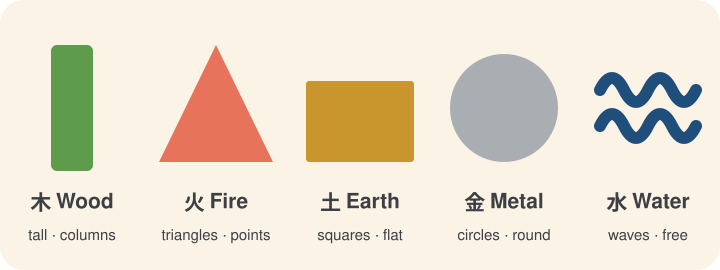
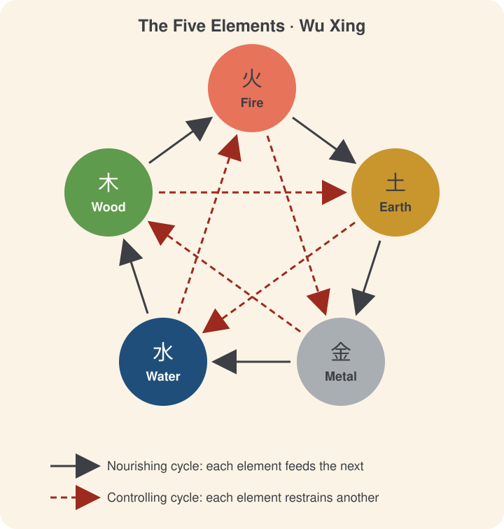

# 3 ✦ Elements & Seasons

∞ ∞ ∞

Every person, brand and product has a dominant element, and every time of year has one too. QEA reads the elements present, balances them, and lets colours and rhythms follow the seasons.

Two traditions are used side by side. They are different maps of the same living world; don't force one onto the other.

## The Five Elements of QEA

From the Western and Vedic traditions. Wherever content can be grouped by element, it follows this order:

| | Element | Qualities | Typical themes |
|---|---|---|---|
| 🜃 | **Earth** | ground, body, stability, abundance | food, home and land; foundations, money, structure |
| 🜄 | **Water** | flow, feeling, healing, cleansing | health and healing; relationships, emotions |
| 🜂 | **Fire** | warmth, passion, creation, transformation | art and gatherings; action, celebration |
| 🜁 | **Air** | movement, mind, communication, life force | learning and services; ideas, exchange |
| ✧ | **Ether** | spirit, space, connection, the whole | spirit and community; purpose, the field |

Example: a directory of local businesses groups its categories as earth (food, home and land) · water (health and healing) · fire (art and gatherings) · air (learning and services) · ether (spirit and community), each drawn with its element symbol.

### Balancing

1. **Read the dominant element:** what a brand already radiates (much Fire: urgency, red, bold claims).
2. **Steady it** with the element that holds it (Fire is held by Water: calm blues, space, slower motion).
3. **Soften it** with the element it flows into (Fire flows into Earth: grounded neutrals, clear structure).
4. Keep **Ether** present in every piece: some space, a ✦, a sense of the whole.

### In Design

- **Earth:** sand, clay, stone and warm neutrals; solid shapes; generous grounding margins.
- **Water:** blues and sea greens; soft curves; flowing layouts.
- **Fire:** warm accents (red, coral, orange, gold), used sparingly for the one main action.
- **Air:** whitespace, light type, pale sky tones, gentle motion (360–1440 ms).
- **Ether:** violet, indigo and luminous gold; sacred geometry; ✦ and ∞.

## The Five Feng Shui Elements (Wu Xing)

In Chinese tradition the five elements are five phases of one transforming energy (qi), each tied to a season, a direction, a shape and colours. Feng Shui ("wind and water") is the art, over 3,000 years old, of bringing a space, an object or a brand into harmony with that energy, held in balance by yin and yang.

| Element | Season | Direction | Properties | Associated with | Shapes | Colours | Fonts |
|---|---|---|---|---|---|---|---|
| **Wood** 木 | spring | east | grows outwards, enduring | growth, renewal, revitalisation, health, vitality, kindness | tall, rectangular, columns, stripes, vertical lines | greens, teal, light brown | thin, narrow, condensed |
| **Fire** 火 | summer | south | spreads in every direction, radiates, hot | passion, energy, excitement, joy, dynamism, visibility; in excess anger and aggression | triangles, points, sharp and edgy, stars | red, orange, purple, pink | angular |
| **Earth** 土 | late summer | centre | attractive, dense, stable | stability, grounding, nourishment, strength, trust, care | squares, cubes, flat and broad | brown, beige, yellow, khaki, sand, terracotta | square, solid |
| **Metal** 金 | autumn | west | sharp, pointing, piercing | clarity, precision, introspection, self-reflection, organisation, structure, productivity | spheres, circles, ovals, arches | white, gold, silver, grey, pastels | rounded |
| **Water** 水 | winter | north | runs downhill, free and unbound | flow, flexibility, purity, cleansing, depth, wisdom, rest | waves, indefinite, free forms | blue, dark blue, black, dark grey | cursive, script |

**Physical objects** that carry each element (in a space, a photograph, an illustration or a product):

| Element | Objects |
|---|---|
| **Wood** | plants, shrubs, trees, flowers, grass, bamboo, ferns, wooden furniture, paper, textiles |
| **Fire** | fire, candles, red lamps, lightning, electricity, light |
| **Earth** | mountains, rocks, stones, bricks, ceramics, clay |
| **Metal** | swords, axes, jewellery, gold, silver, iron, copper, coins, bells |
| **Water** | ponds, swimming pools, fountains, lakes, seas, aquariums, mirrors and glass |

Going deeper: [Feng Shui for Brands & Business](3a-feng-shui-business.md) (logos, colours, layout, the Bagua, the element of each industry, the owner's Bazi) and [The Five Element Personalities](3b-element-personalities.md).

### How the Elements Relate: the Cycles

All five elements are related through cycles, in which one element produces, controls or weakens another.

**The nourishing cycle** (also productive, growth or strengthening): each element feeds and strengthens the next.

| | Because |
|---|---|
| Wood → Fire | wood feeds the fire |
| Fire → Earth | fire leaves ash, which becomes earth |
| Earth → Metal | metals and minerals are mined from the earth |
| Metal → Water | water condenses on cool metal; melted metal flows like water |
| Water → Wood | water makes plants grow |

**The controlling cycle** (also called the clashing or destructive cycle): each element keeps another in check. In balance it restrains; out of balance it destroys.

| | Because |
|---|---|
| Fire → Metal | fire melts metal |
| Metal → Wood | the axe cuts wood |
| Wood → Earth | roots grip the earth and draw its nutrients (why soil needs feeding) |
| Earth → Water | the earth channels water and holds it back, like a dam or mud after rain |
| Water → Fire | water puts out fire |

**The weakening cycle** (also draining or exhaustive): the nourishing cycle backwards. Whatever grows takes its energy from what feeds it.

| | Because |
|---|---|
| Fire weakens Wood | the fire uses up the wood |
| Wood weakens Water | the plant drinks the water |
| Water weakens Metal | water makes metal rust |
| Metal weakens Earth | mining digs out the earth |
| Earth weakens Fire | earth can't burn; enough earth smothers a fire |

**To balance, prefer the weakening cycle over the controlling one.** A clash can do more harm than good: water poured on fire makes smoke and scalding splashes. Calm too much Fire with Earth (it drains Fire gently) before reaching for Water.

### What the Cycles Mean for Colour

Colours next to each other in the nourishing cycle feel harmonious together: green with red or pink, red with sand, ochre with white or gold, grey with navy, deep blue with green.

Pairs in the controlling cycle create tension: red on silver, navy on orange, green on ochre. Use them on purpose, for a contrast that should catch the eye, or to calm an element that dominates.

To balance with colour:

| Too much | Feels | Calm it with | Colours |
|---|---|---|---|
| Fire | restless, loud, urgent | Earth (drains Fire) or Water (controls it) | sand, ochre, terracotta; navy accents |
| Water | heavy, cold, hard to start | Wood (drains Water) or Earth (controls it) | greens; warm neutrals |
| Wood | busy, scattered | Fire (drains Wood) or Metal (controls it) | soft red or pink accents; white, grey |
| Earth | dull, stuck | Metal (drains Earth) or Wood (controls it) | white, gold; fresh green |
| Metal | cold, strict, distant | Water (drains Metal) or Fire (controls it) | deep blue; warm coral or rose |

### Bridging the Two Traditions

Earth, Water and Fire share their names and meanings. Air lives in both **Wood** (wind, movement, spring) and **Metal** (breath, clarity, autumn). Ether is the space that holds all five phases.

## The Seasons

Each season carries its element's energy. A brand, a campaign or a product can breathe with the year: a seasonal palette, a seasonal photograph, an offer that fits the season's energy, a release planned at its start.

| Season | Element | Energy | Good for |
|---|---|---|---|
| Spring | Wood | awakening, growth | launches, beginnings, learning |
| Summer | Fire | fullness, joy, visibility | events, celebrations, being seen |
| Late summer | Earth | harvest, nourishment | gathering, gratitude, community |
| Autumn | Metal | clarity, letting go | reviews, simplifying, finishing |
| Winter | Water | rest, depth | reflection, planning, inner work |

**Where you are matters.** In the southern hemisphere the seasons are reversed (spring from September). Near the equator, follow the local rhythm (rainy and dry seasons, harvests, festivals) and map it to the element whose energy fits.

### A Palette for Each Season

Six colours per season, all aligned. Deep colours carry text on light backgrounds; light ones are surfaces. Data in [`palette/seasons.json`](../palette/seasons.json), CSS in [`palette/seasons.css`](../palette/seasons.css).

| Season · Element | Deep | Middle | Light |
|---|---|---|---|
| **Spring · Wood** | Deep Fern `#2e6b39` | Leaf `#5f9b4d` · Fresh Shoot `#a8d08c` · Blossom `#f4c6d1` | Spring Sky `#cfe6f4` · Morning Light `#f6f9ed` |
| **Summer · Fire** | Ember `#9c2a1e` | Coral `#e8735b` · Hibiscus `#d94f79` · Sun Orange `#f29e3e` | Sunflower `#fbd969` · Warm Light `#fff4e9` |
| **Late Summer · Earth** | Umber `#6b4a2c` | Terracotta `#b5643d` · Ochre `#c9962d` · Sand `#e8d3a9` | Wheat `#f3e6c4` · Clay Light `#faf3e6` |
| **Autumn · Metal** | Graphite `#3d3f44` · Rust `#9b4a23` | Burnished Gold `#b08d3d` · Silver `#a9aeb3` | Pearl `#ecebe7` · Clear White `#fbfbf8` |
| **Winter · Water** | Night Ink `#0b1321` · Midnight `#14213d` · Deep Water `#1f4e7a` · Slate `#4a5d73` | | Ice `#cfe0ee` · Frost `#eef3f8` |

Text-safe on white (4.5 : 1 or more): Deep Fern, Ember, Umber, Graphite, Rust and all the winter deeps. Middle colours are for large text, icons, illustrations and surfaces; check contrast for anything else.

A season's palette can be the whole look (a seasonal campaign) or one accent added to a brand's own palette for that time of year. Keep the brand's text and action colours steady all year, so people always find their way.

---
[← Colours](2-colours.md) · [Symbols →](4-symbols.md)
