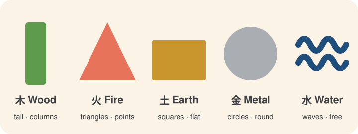
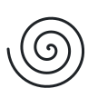
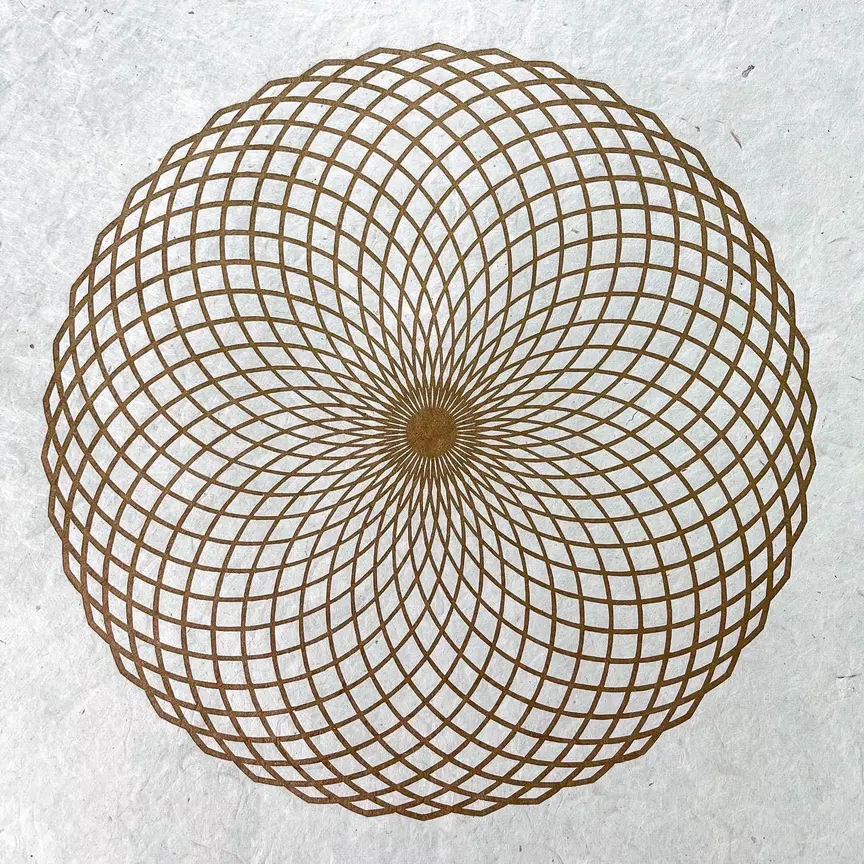
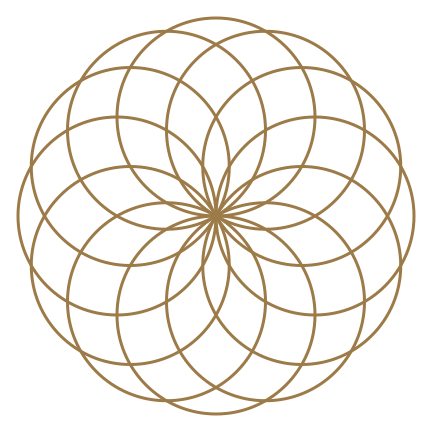

# 3 ✦ Shapes & Symbols

∞ ∞ ∞

Every shape carries a quality: a circle feels whole, a point feels sharp, a wave feels free. Traditions around the world hold sacred geometry, healing signs and symbols as carriers of a good vibration and of protection. QEA uses shapes with intention, and symbols few and meaningful, to hold a field around a person, a business and its work.

## Shapes of the Elements

| Element | Shapes | Feels |
|---|---|---|
| **Wood** | tall, rectangular, columns, stripes, vertical lines | growing, alive |
| **Fire** | triangles, points, stars, sharp edges | energetic, bright |
| **Earth** | squares, cubes, flat and broad forms | stable, safe |
| **Metal** | circles, spheres, ovals, arches | clear, whole |
| **Water** | waves, free and flowing forms | soft, deep |

Balance shapes as you balance the elements (see [Elements](7-elements.md)).

## Shape Carries Energy

BioGeometry (see [Spaces & Architecture](apply-spaces.md#biogeometry)) describes every shape as carrying an energy quality through its form alone, with a balanced centre bringing harmony. In practice: prefer whole, centred, balanced shapes and gentle curves; keep a calm centre; avoid crowded, broken or aggressive forms where people should feel at ease.

## Core Symbols

Nine core symbols, few and meaningful:

| Symbol | Name | Use |
|---|---|---|
| ✦ | Star | Frames a call to action on both sides (`✦ Book Your Session ✦`); separates a title from its subtitle (`Your Practice ✦ From Goals to Alignment`); marks list items and questions |
| ✧ | Open star | The softer accent: a signature after a name (`Meet Anna ✧`), list items in calm texts |
| ∞ ∞ ∞ | Infinity | The divider under a section title or between sections |
| ∞ | Infinity (single) | Abundance, the unbroken flow |
| \|\|∿ | Lines and sinus curve | From New Homeopathy (see below). Placed right after a heavy word or pattern, to turn and release it: `limiting beliefs ||∿` (see [Words](4-words.md)) |
| ♥ | Heart | What is given from the heart; care, gratitude |
| ☉ | Sun | Light, life force, a beginning: sunrise practices, the solstices and equinoxes, a new start (see [Time & Rhythm](8-time-rhythm.md#the-day)) |
| ☽ ● ◐ ○ ◑ | Moon and its phases | Cycles and timing: the moon phase of a gathering or launch, moon circles, dates on flyers (see [The Moon](8-time-rhythm.md#the-moon)) |
|  | Spiral, turning to the left | Growth, evolution, the path inward and back out; a journey, a programme, a process of change. Always drawn as an icon, turning counter-clockwise from its centre |

## Sacred Geometry

| Form | Carries | In a product |
|---|---|---|
| Circle | wholeness, unity, protection | avatars, frames, loaders |
| Triangle | direction, the three, creation | arrows, emphasis (Fire) |
| Hexagon | harmony, order of nature (the honeycomb) | badges, codes, grids |
| Seed of Life | creation, the beginning | backgrounds, placeholders |
| Lotus Flower of Life | life renewing itself from its centre, the open heart | backgrounds, films, ornaments (in place of the Flower of Life, see below) |
| Vesica Piscis | meeting, the space between two | logos, transitions |
| Golden ratio (1 : 1.618) | natural proportion, beauty | layout proportions (a standard of its own; it may sit beside 3 · 6 · 9) |

## The Lotus Flower of Life

**QEA uses the Lotus Flower of Life instead of the Flower of Life.** Its frequency is higher and more harmonious: it opens from one centre and turns around it like a blossom, instead of repeating outward in a flat six-fold grid.

| | Flower of Life | Lotus Flower of Life |
|---|---|---|
| **Built from** | circles of one size, each centred on the edge of its neighbours, repeating outward | circles of one size, all passing through one shared centre and turning around it |
| **Symmetry** | 6-fold | 12-fold (or a multiple of 12 for a richer bloom) |
| **Feels** | a pattern, a grid | a blossom, alive, renewing itself from its source |
| **Echoes** | the honeycomb, the snowflake | the 12-petal lotus of the heart (*Anahata*); in three dimensions, the twelve spheres that fit around one |

**How to draw it** by hand, with a compass:

1. Draw a circle; its centre is the centre of the Lotus.
2. Mark 12 equal points on that circle (every 30°).
3. With the same radius, draw a circle around each of the 12 points. Every circle passes through the centre, and the petals open around it.

For a fuller bloom, as in the print above, use 24 or 36 circles. Keep the count a multiple of 3, and the centre calm and open.

**In a product:** use the Lotus wherever the Flower of Life would have been: behind a welcome at 9 % opacity, as a texture on print, in a film's opening, as an ornament on a certificate. Draw it as an SVG so it stays sharp at every size.

**Keep it open.** Never enclose the Lotus in a circle, a ring or a frame. A boundary makes it finite, and the Lotus stands for life without end. Let its petals end freely. The circle with its dot (the circumpunct ☉) is a symbol of its own: place it elsewhere on the page, never around the Lotus.

## Many Symbols, Each in Its Place

Sacred geometry offers hundreds of forms. Repeating one symbol on every page or screen flattens it into decoration. Choose a symbol for what each page holds: the Lotus for life and the heart, the spiral for a journey, the Seed of Life for a beginning, the Vesica Piscis for a meeting, the sun for a new start. Keep each one few and meaningful (see [Usage](#usage)), and let the variety carry the story.

## Signs of New Homeopathy

New Homeopathy (*Neue Homöopathie*) was developed by the Austrian engineer **Erich Körbler** (1938–1994). It works with simple geometric signs which, as its practitioners describe, carry information that balances a person's energy. They are drawn on the skin, on water, on objects or written on a note, traditionally after testing with a one-hand rod.

| Sign | Name | Described effect |
|---|---|---|
| \| \| \| | Lines (the line code) | harmonise and balance; the number of lines matters |
| ∿ | Sinus curve | transforms, smooths and turns a disturbance |
| Y | Ypsilon | strengthens; brings energy to where it's needed |
| ✕ | Cross | erases or neutralises a disturbing pattern |

QEA's **\|\|∿** draws on this language: lines that balance, followed by the sinus curve that turns.

In a product, these signs can live quietly: inside a pattern, an icon's geometry, a printed card, the back of a package, or openly in a wellbeing product whose users know and want them. Learn the signs from a trained practitioner or Körbler's own writings before using them, and describe them as a practice, never as a treatment.

## Elements

The alchemical signs 🜃 🜄 🜂 🜁 and ✧ name the five elements wherever they appear (see [Elements](7-elements.md)).

## Usage

- **Few and meaningful:** one ✦ pair per call to action, one ∞ ∞ ∞ per section at most.
- **Varied, not repeated:** choose the symbol that fits each page instead of one symbol everywhere (see [Many Symbols, Each in Its Place](#many-symbols-each-in-its-place)).
- **Drawn or typed, never as emoji pictures:** prefer the typographic symbol or a drawn icon over colourful emoji. Never yellow smiley faces in interfaces.
- **Where a font can't draw a symbol** (link preview images, some PDFs), draw it as an SVG instead of leaving an empty box.
- **Respect origins:** symbols from living traditions are used with respect and their meaning intact, never as decoration that contradicts them.
- **Quiet integration:** symbols may also live where they aren't seen at first glance (a texture, an icon's geometry, a code comment). See [Images & Films](apply-images-films.md).

---
[← Colours & Light](2-colours-light.md) · [Words →](4-words.md)
