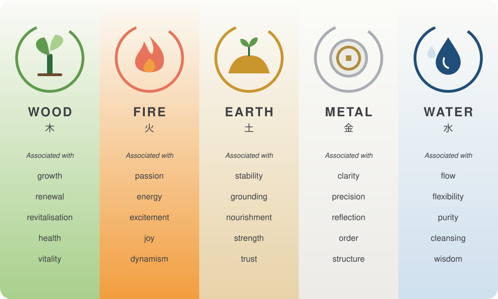
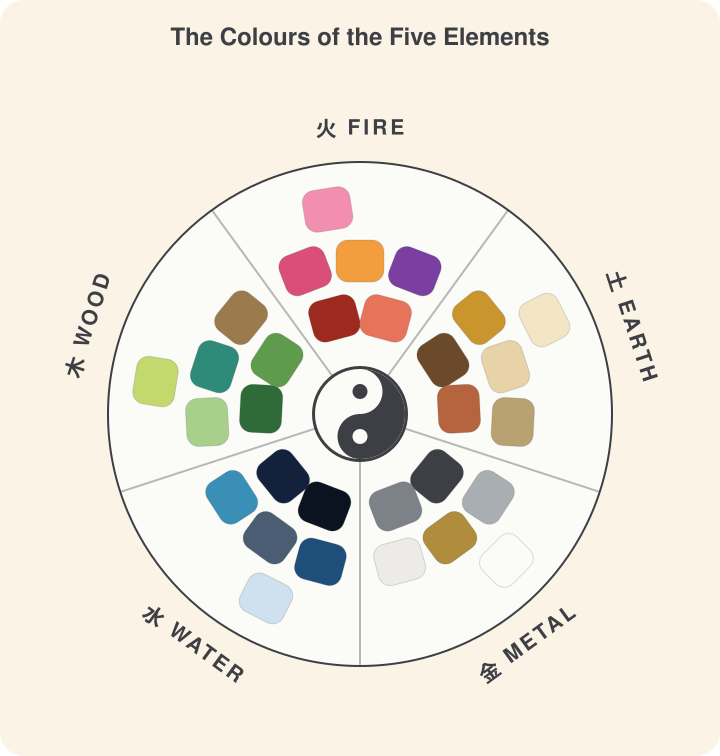

# Feng Shui for Brands & Business

∞ ∞ ∞

In business Feng Shui, a company's logo, fonts and colour scheme are strengthened with the five elements. The same elements then carry through everything the business shows: marketing, promotion, social media, the website, print, the space. A brand designed this way isn't only seen, it is felt: balanced, trustworthy and in harmony with the people it serves.

The elements, their colours, shapes and cycles are on [Elements & Seasons](3-elements-seasons.md#the-five-feng-shui-elements-wu-xing).

## Finding a Business's Elements

1. **The element of the industry:** what the business does (see the tables below).
2. **The owner's element:** the element that is most favourable in the owner's Bazi chart (see [Matching the Owner's Bazi](#matching-the-owners-bazi)).
3. **What the brand wants to radiate:** growth (Wood), passion (Fire), trust (Earth), clarity (Metal), flow (Water).
4. **Balance them** with the cycles: strengthen with the element that nourishes, soften with the element that drains, and keep the one that controls for a deliberate accent.

A bank, for example, is a Metal business; to radiate trust it adds Earth, which nourishes Metal. A wellness studio is Wood; Water nourishes it.

## The Element of Each Industry

### 火 Fire Industries

火 · 亮丽 bright and beautiful · 热能 heat · 光电 light and electricity · 礼仪 ceremony · 火爆 fiery, booming · 文明 civilisation · 战争 war

Anything that uses **light, heat or electricity**, and anything that **improves appearance**.

- **Technology and media:** AI, the internet, e-sports, IT, computers, mobile devices, electronics, semiconductors, robotics, multimedia, advertising, printing, film, photography, lighting, lasers
- **Art and stage:** fine arts, artists, graphic design, singers, dancers, celebrities
- **Beauty:** cosmetics, beauty salons, aesthetic and facial surgery, botulinum, manicure, pedicure, aromatherapy
- **Energy and chemistry:** electrical engineering, energy, fuel, gas, oil and petroleum, chemistry, thermal, fireworks, plastics
- **Science and mind:** genetics, the genome, psychology
- **Food and drink:** hotpot, barbecue, liquor

### 金 Metal Industries

金 · 机械 machinery · 制造 manufacturing · 道义 righteousness · 果断 decisiveness · 权威 authority · 操控 control

Work with **metal, money, machines and physical force**.

- **Money:** finance, banks, insurance, accountancy, auditing, debt collection, pawn shops, gold and silver
- **Making:** manufacturing, machining, car makers, engineering and mechanical engineering, moulding, metalwork, mining, glass
- **Hardware:** hardware shops and stalls, keys
- **Protection:** the military and army, police, security

### 木 Wood Industries

木 · 文化 culture · 宗教 religion · 新生 new life · 恻隐心 compassion · 植物 plants · 滋生 growth · 仁正 benevolence and uprightness

Work that **helps or educates people**, mentally or spiritually, and work with **plants, paper and fabric**.

- **Health and care:** health care, doctors, nurses
- **Education and culture:** education, teachers, educators, professors, learning, culture, religion, libraries and librarians
- **Words:** writers, novelists, journalists, publishers, cultural publications, bookshops, paper, stationery, office supplies
- **Plants and land:** agriculture, plantations, organic and vegan food, botany, florists, gardening, timber
- **Wood and fabric:** carpentry, wooden furniture, textiles, fabric, curtains, clothing

### 水 Water Industries

水 · 智慧 wisdom · 流动 flow · 娱乐 entertainment · 寒散虚 cold, scattered, intangible

Highly **mobile** businesses, and work with **water, change, travel, the outdoors, intellect, entertainment or cold**.

- **Water and sea:** marine and naval, sailing, yachts, aquariums, spas, swimming coaches, fire fighting, cleaning companies; anything that needs water or liquid to produce
- **Travel and movement:** travel and tourism, transport, coaches, trains and railways, air conditioning
- **Food and drink:** restaurants, food stalls, coffee shops (kopi tiam), cold drinks, sauces; cold and refrigerated goods such as ice cream, fish, meat and fruit
- **Trade and chance:** retail, stocks and shares, casinos
- **Entertainment and the outdoors:** illusionists, outdoor newscasters, sportspeople

### 土 Earth Industries

土 · 信用 trustworthiness · 包含 holding · 稳固 stability · 基础 foundation · 中介 agency, the middle

Work with **earth, soil, land or rock**.

- **Land and buildings:** real estate and property, estate agents, architecture, building, construction, building materials, renovation, demolition, car parks
- **Stone and clay:** marble, stone masonry, sculpture, ceramics, pottery, mining
- **Keeping and returning:** storage and warehousing, antiques, pawn shops, recycling, landfill
- **Animals:** dogs (the Dog is an Earth sign)

## Matching the Owner's Bazi

Besides the business type, the elements can also match the owner. Bazi (the "eight characters" of the moment of birth) shows which element is strong or weak in a person, and which is most favourable to them.

- **A weak element needs its nourisher.** A "weak Wood" owner is suited to a Water business, because Water nourishes Wood.
- **A strong element needs an outlet.** A "strong Wood" owner is suited to Earth, because Wood controls Earth, and the element a person controls is their wealth.

A Bazi reading is done by a practitioner from the date, time and place of birth.

## Logos

A logo is a brand's visual anchor: its identity, values and aspiration in one glance. Built with Feng Shui, it carries balance and positive energy as well, and is remembered and trusted more easily.

### Elements in a Logo

| Element | Energy | Suits | In the logo |
|---|---|---|---|
| **Wood** | growth, vitality, beginnings | start-ups, health and wellness, education, eco brands | greens, tree and leaf motifs, vertical lines, tall forms |
| **Fire** | transformation, passion, warmth, light | creative agencies, entertainment, beauty, tech innovators | reds and oranges, angular shapes, flames, stars |
| **Earth** | stability, grounding, nurture, trust | real estate, care, consultancies, anything that should feel reliable | browns, tans, yellow, beige; squares; landscapes |
| **Metal** | clarity, precision, efficiency, quality | finance, luxury, tech, consultancies | white and metallic shades, circles, coins |
| **Water** | flow, wisdom, adaptability, connection | global brands, communication, travel, education | blues and black, wavy lines, water forms |

### Colours

- **Red** (Fire): passion, dynamism, warmth; demands attention. Food, entertainment, fashion.
- **Green** (Wood): growth, renewal, freshness, harmony; calm and balancing. Health, wellness, the environment. Soft pastels to deep emeralds carry different energies.
- **Yellow and beige** (Earth): stability, nourishment, trust; warm and neutral. Education, NGOs, consultancies.
- **White and metallic** (Metal): purity, clarity, precision; sleek and timeless. Tech, luxury, new ventures.
- **Blue and black** (Water): wisdom, depth, adaptability, vastness. Global companies, communication, travel.

The full colour families of each element, aligned: see [A Palette for Each Season](3-elements-seasons.md#a-palette-for-each-season) and [Colours](2-colours.md).

### Shapes

- **Rectangle** (Wood): upward growth with stability; innovation, growth, sustainability.
- **Triangle** (Fire): energy, power, ambition; pioneers, technology, entertainment.
- **Square** (Earth): stability, balance, foundation; finance, property, anything steadfast.
- **Circle** (Metal): wholeness, unity, the infinite; community, perfection, a global outlook.
- **Wavy lines** (Water): grace, flow, flexibility; travel, communication, the creative.

### Fonts

Fonts carry their element too: thin and narrow for Wood, angular for Fire, square and solid for Earth, rounded for Metal, cursive and script for Water.

### Position and Flow

Qi needs to flow freely, in a logo as in a room.

- **Central focus:** the centre is balance and grounding. The main symbol in the centre anchors the brand's core message and feels stable.
- **Directional flow:** the arrangement guides the eye. Upward movement says growth and aspiration; horizontal flow says stability and connection.
- **Breathing room:** open space lets the qi circulate and each part stand out. Cluttered logos overwhelm; space brings clarity and recall.
- **Harmony of elements:** no single shape, colour or symbol overpowers another.
- **Interaction:** parts that overlap, intertwine or merge do so seamlessly, so their energies strengthen each other.

QEA's own rules join here: sizes, spacing and radii in 3 · 6 · 9 (see [Numbers](1-numbers.md)), sacred geometry (see [Symbols](4-symbols.md)).

### The Bagua

The Bagua map divides a space into nine areas, a 3 × 3 grid, each with its life theme, element and colour. It analyses rooms and buildings, and serves just as well as a guide for placing the parts of a logo, a page or a print. Laid with the entrance (or the reader's starting point) at the bottom:

| | | |
|---|---|---|
| **Wealth & abundance** · Wood · purple, gold | **Fame & reputation** · Fire · red | **Love & relationships** · Earth · pink |
| **Family & roots** · Wood · green | **Health & centre** · Earth · yellow, earth tones | **Creativity & children** · Metal · white |
| **Knowledge & wisdom** · Earth · blue | **Career & path** · Water · black, deep blue | **Helpful people & travel** · Metal · grey |

On a page or a flyer: the main message in the centre (health, balance), what the brand wants to be known for at the top (fame), the next step for the reader near the bottom (path). In a shop or studio: see [Spaces](9-products-spaces.md#spaces).

## Across Every Channel

Once the elements are chosen, they flow into everything:

- **Website and app:** palette, shapes of buttons, cards and icons, fonts, the rhythm of motion.
- **Social media:** a feed that keeps the element's colours and forms; photographs with its objects (plants for Wood, candles and light for Fire, stone for Earth, metal and white for Metal, water for Water).
- **Print and packaging:** flyers, cards and bags in the element's colours and shapes, on [aligned dates](9-products-spaces.md#aligned-dates).
- **Space:** the shop, studio or office, placed by the Bagua and the directions.

---
Sources: business Feng Shui industry lists; [thefengshuiacademy.com/5-elements](https://www.thefengshuiacademy.com/5-elements/) (cycles).

[← Elements & Seasons](3-elements-seasons.md) · [The Five Element Personalities →](3b-element-personalities.md)
